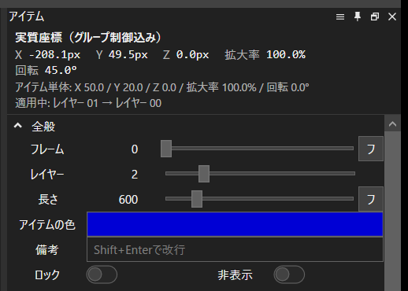

# 実質座標表示 (EffectivePosition)

YMM4（ゆっくりMovieMaker4）用プラグイン。

グループ制御の中に置いたアイテムが、画面上で実際にどこにあるか（グループ制御で動かした分を足し込んだ「実質座標」）を、アイテム編集パネルの一番上に表示します。

## できること

- アイテムを 1 つ選ぶと、アイテム編集パネルの上端に表示します。
  - **X / Y / Z / 拡大率 / 回転**: グループ制御込みの値
  - **アイテム単体**: アイテム自身の値（比較用）
  - **適用中**: 効いているグループ制御のレイヤー（内側 → 外側の順）
- 再生位置を動かすと追従します。キーフレームの動きも、そのフレームの値で計算します。
- 入れ子のグループ制御、「グループのみ対象」、グループ範囲、非表示のグループ・レイヤー、画像化したグループ制御に対応しています。
- メニューの「ツール」→「実質座標表示」で、同じ内容を別ウィンドウにも出せます。

## 導入

[Releases](../../releases/latest) から `YMM4-EffectivePosition-v*.zip` をダウンロードして展開し、中の `EffectivePosition.ymme` をダブルクリックするか YMM4 の画面にドラッグ＆ドロップしてインストールします。YMM4 を再起動すると使えます。

手動で入れる場合は、zip の `manual-install\EffectivePosition` フォルダを YMM4 のフォルダの `user\plugin\` に置いてください。

## 注意

- 映像エフェクト（座標移動・振動など）による移動は含みません。アイテムや効いているグループ制御に有効な映像エフェクトがあると注記が出ます。
- 「画像中心」で画像化したグループ制御の中にほかのアイテムもある場合は近似値です（中身全体の描画範囲で中心が決まるため）。この場合も注記が出ます。
- 再生位置がアイテムの外にあるときは、アイテムの端のフレームで計算します。
- アイテム編集パネルへの表示は YMM4 の非公開の画面構成を利用しています。YMM4 の更新で表示されなくなった場合も、ツールメニューのウィンドウは使えます。
- 動作確認: YMM4 v4.56.1.1

## 計算の確かめ方

`tests/RenderCheck` は、YMM4 本体の描画処理で実際にフレームを描き、図形の重心・面積・向きをこのプラグインの計算値と突き合わせるテストです（入れ子・グループのみ対象・範囲外・非表示・キーフレーム・画像化など 15 ケース）。

## ビルド

.NET 10 SDK が必要です。

1. `Directory.Build.props.sample` を `Directory.Build.props` にコピーし、`YMM4DirPath` に YMM4 のフォルダを書きます。
2. `python build.py` で `dist/` に `.ymme` と配布用 zip ができます。

テストは `tests/RenderCheck` をビルドし、`RenderCheck.exe "<YMM4 のフォルダ>"` で実行します。

## ライセンス

[MIT](LICENSE)
